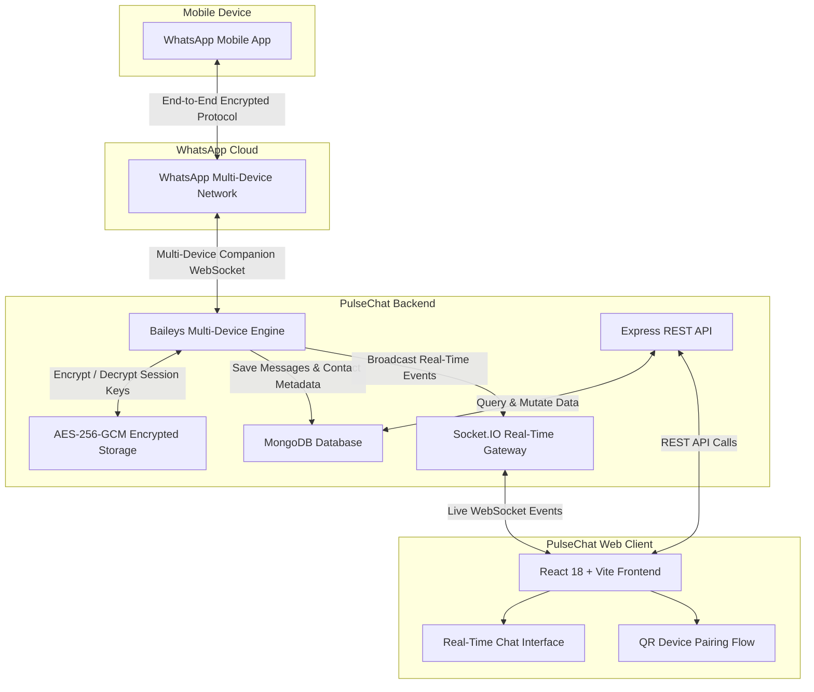

# ⚡ PulseChat — Modern Multi-Tenant WhatsApp Web Platform

<div align="center">


**A full-stack, enterprise-grade WhatsApp Web platform that enables users to link their personal or business WhatsApp accounts via QR code, maintain persistent chat histories in a database, and message in real time through an ultra-responsive web dashboard.**

[Overview](#-overview) • [Key Features & Use Cases](#-key-features--use-cases) • [Architecture](#-system-architecture) • [Security & Reliability](#-security--reliability) • [Tech Stack](#-tech-stack) • [Quick Start](#-quick-start--installation) • [How to Use](#-how-to-use-step-by-step)

---

</div>

## 📖 Overview

**PulseChat** is an open-source, full-stack web application that transforms the WhatsApp Multi-Device protocol into a multi-user, web-accessible messaging suite. Built on top of `@whiskeysockets/baileys`, PulseChat eliminates the need for expensive third-party WhatsApp Business API aggregators.

Any registered user can securely link their personal or business WhatsApp phone number by scanning an in-app QR code. Once linked, users can view all conversations, send and receive messages, inspect media, and track delivery receipts directly from their browser—with full two-way synchronization to their physical phone.

Unlike standard web scrapers or stateless bots, PulseChat provides:
- **True multi-tenancy** with cryptographic session isolation.
- **Database persistence** (MongoDB) so messages and chat histories are permanently preserved.
- **Real-time bidirectional synchronization** via Socket.IO.
- **Bank-grade security** with AES-256-GCM encryption for stored session keys.

---

## 🚀 Key Features & Use Cases

### 1. 📱 Use Your Personal or Business WhatsApp
- **No Costly APIs Needed:** You do not need third-party enterprise API gateways (like Twilio, MessageBird, or WATI).
- **Direct QR Linking:** Simply scan the dynamic QR code using **WhatsApp > Linked Devices** on your smartphone.
- **Multi-Device Protocol:** Operates as an official companion device. Even if your smartphone loses its internet connection, your web dashboard remains operational.

### 2. 🔄 Two-Way Real-Time Synchronization (Mobile ⇄ Web)
- **Sent from Mobile Phone:** When you send a message from your physical phone, it immediately appears on the web dashboard in real time without refreshing.
- **Sent from Web Dashboard:** Messages sent from the browser are delivered to the recipient instantly and appear in your phone's WhatsApp chat history.
- **Instant Incoming Messages:** Replies from contacts arrive on both your phone and the web dashboard simultaneously with 0ms latency.
- **Live Delivery & Read Receipts:** Sent (`✓`), delivered (`✓✓`), and read (`blue ticks`) statuses update dynamically.

### 3. 💾 Persistent Chat History (Saved & Searchable)
- Traditional WhatsApp Web requires long loading screens on every login and can lose local state. PulseChat permanently persists all conversations and message logs in a **MongoDB Database**.
- Browser refreshes, closed tabs, or backend restarts never erase your chat history.
- Message history is instantly queryable and ready to search at any time.

### 4. 🧠 WhatsApp Privacy LID & JID Auto-Linking
- Modern WhatsApp accounts (especially WhatsApp Business and privacy-enabled accounts) frequently use internal **LID (`@lid`)** identifiers, often causing duplicate threads in standard integrations.
- PulseChat features an automated **LID & JID Unification Engine** that identifies when a phone number (`@s.whatsapp.net`) and a privacy LID (`@lid`) belong to the same contact, merging them into a single coherent conversation thread.

### 5. ⚡ High Reliability & Zero-Downtime Session Recovery
- **Automatic Reconnection on Server Boot:** When the backend server restarts, it automatically detects active database sessions and restores WhatsApp connections in the background—**no need to scan the QR code again**.
- **Resilient WebSockets:** The frontend includes automatic backoff and reconnection logic to maintain smooth socket connectivity through network interruptions.

---

## 🔒 Security & Reliability

| Security Pillar | Implementation |
| :--- | :--- |
| **Multi-Tenant Isolation** | Strict cryptographic boundary between users. User A can never view User B's WhatsApp sessions, contacts, or messages. |
| **AES-256-GCM Session Encryption** | WhatsApp Signal keys, tokens, and cryptographic secrets stored on disk are encrypted using **AES-256-GCM** authenticated encryption. |
| **JWT Token Pair with Rotation** | Secure authentication using short-lived JWT access tokens and HttpOnly refresh token rotation. |
| **Anti-Spam & Account Protection** | Designed strictly for human-to-human manual communication. Built-in cooldown intervals and rate limiting safeguard linked numbers from WhatsApp anti-spam bans. |
| **Audit Trails & Logs** | Detailed IP address and timestamp logging for all authentication attempts, session connections, and critical security operations. |
| **Safe Git Standards** | Strict `.gitignore` configuration guarantees that session files (`auth_sessions/`), environment keys (`.env`), and credentials are never tracked. |

---

## 🏗️ System Architecture



---

## 💻 Tech Stack

| Layer | Technology | Details |
| :--- | :--- | :--- |
| **Frontend UI** | **React 18 + TypeScript** | Modular, type-safe component architecture |
| **Styling** | **Tailwind CSS** | Dark charcoal + Electric blue WhatsApp theme & light mode support |
| **Build Tool** | **Vite + SWC** | Ultra-fast HMR and optimized production bundles |
| **Icons** | **Lucide React** | Lightweight, modern SVG iconography |
| **Backend Runtime** | **Node.js + Express** | High-performance asynchronous API server |
| **WhatsApp Core** | **`@whiskeysockets/baileys`** | Direct multi-device protocol companion engine |
| **Real-Time Sync** | **Socket.IO** | Bi-directional, low-latency WebSocket gateway with room isolation |
| **Database** | **MongoDB Atlas + Mongoose** | Persistent storage for users, conversations, and audit logs |
| **Security** | **AES-256-GCM + Bcrypt + JWT** | At-rest session encryption, password hashing, and token authentication |

---

## 🛠️ Quick Start / Installation

### Prerequisites
- **Node.js** v18+ (Node v20 or v22 recommended)
- **npm** v9+
- **MongoDB** (Local instance or free MongoDB Atlas URI)

### 1. Clone the Repository
```bash
git clone https://github.com/SahilRajput2266/PulseChat.git
cd PulseChat
```

### 2. Configure Environment Variables
Create `server/.env` based on the example below:

```bash
# Server Configuration (server/.env)
PORT=5000
NODE_ENV=development
MONGODB_URI=mongodb+srv://<username>:<password>@cluster0.mongodb.net/pulsechat
JWT_ACCESS_SECRET=your_super_secret_access_key_min_32_characters_long
JWT_REFRESH_SECRET=your_super_secret_refresh_key_min_32_characters_long
SESSION_ENCRYPTION_KEY=your_32_byte_aes_gcm_hex_key_here
CORS_ORIGIN=http://localhost:5173
```

> **Tip:** Generate a secure 32-byte hexadecimal encryption key by running:
> ```bash
> node -e "console.log(require('crypto').randomBytes(32).toString('hex'))"
> ```

### 3. Install Dependencies
Install dependencies for both backend and frontend:

```bash
# Install backend packages
cd server
npm install

# Install frontend packages
cd ../client
npm install
```

### 4. Run Development Servers
Start both services in parallel terminals:

```bash
# Terminal 1: Backend Server (Port 5000)
cd server
npm run dev

# Terminal 2: Frontend Client (Port 5173)
cd client
npm run dev
```

Open your browser at: **[http://localhost:5173](http://localhost:5173)**

---

## 📱 How to Use (Step-by-Step)

1. **Register an Account:**
   - Navigate to `http://localhost:5173` and create an account with your Email and Password.
2. **Connect Your WhatsApp:**
   - Click the **"Connect WhatsApp"** button in the header.
   - A dynamic **QR Code** will be generated and displayed on screen.
   - On your phone, open WhatsApp ➔ **Settings** (or 3 dots) ➔ **Linked Devices** ➔ **Link a Device** ➔ Scan the QR code.
3. **Start Messaging:**
   - Once scanned, your phone number and status will show **"Connected"**.
   - Click **"+ New Chat"**, enter the recipient's phone number with country code (e.g., `+1234567890` or `+919876543210`), and start chatting.
4. **Experience 2-Way Live Sync:**
   - Messages sent from either the web app or your phone will sync across both screens in real time.
   - Full message history and contacts remain permanently saved in MongoDB.

---

## 📄 License & Disclaimer

This project is licensed under the **MIT License**.

> **Disclaimer:** PulseChat is an independent open-source project and is not affiliated, associated, authorized, endorsed by, or in any way officially connected with WhatsApp Inc. or Meta Platforms, Inc. Use this software responsibly and in accordance with WhatsApp's Terms of Service.
