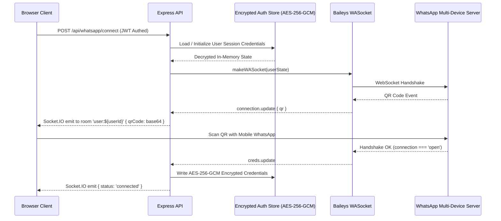

# PulseChat — Multi-User WhatsApp Messaging Web Application

PulseChat is a modern, production-minded, multi-tenant WhatsApp Web client. Built with **React 18**, **Tailwind CSS**, **Node.js/Express**, **Socket.IO**, and **Baileys (`@whiskeysockets/baileys`)**, it enables users to register independent accounts, link their own personal WhatsApp devices securely via real-time QR codes, and manually send one-to-one messages from a WhatsApp-inspired web interface.

---

## 🌟 Key Features

### 1. Isolated Multi-User WhatsApp Sessions
- **Dedicated Sessions**: Each registered PulseChat user owns an isolated Baileys socket session.
- **AES-256-GCM Encrypted Storage**: All sensitive Baileys Signal keys, credentials, and app states are encrypted at rest with authenticated AES-256-GCM.
- **Strict Tenant Boundary**: MongoDB collections (`Conversation`, `Message`, `WhatsAppSession`, `AuditLog`) and Socket.IO rooms (`user:${userId}`) enforce tenant isolation on every read and write.
- **No Shared Keys or Paths**: Each account operates in an isolated filesystem storage directory that is decrypted only in-memory inside that user's session.

### 2. Real Baileys QR Pairing Flow
- **Real-Time QR Codes**: Baileys `connection.update` events are captured, converted to high-definition data URLs, and streamed to the user's browser via Socket.IO.
- **Connection Lifecycle Management**: Handles `connecting`, `connected`, `reconnecting`, `disconnected`, and `error` states gracefully with automatic retry on temporary network dropouts.
- **Guided Onboarding**: A 4-step interactive flow walks new users through account creation, WhatsApp device linking, verification, and first-message guidelines.

### 3. WhatsApp Web-Inspired Interface
- **Theme Palette**: Dark charcoal / near-black surfaces (`#0B0E14`, `#11151E`, `#161C27`) with electric-blue accents (`#2563EB`, `#3B82F6`), alongside a clean light mode.
- **Conversation List**: Search by name or phone number, unread badges, status receipts, and timestamp formatting.
- **Message Stream**: Distinct incoming and outgoing speech bubbles, date dividers, auto-scroll with quick scroll-to-bottom button, copy message utility, and message retry for failed dispatches.
- **Composer**: Multiline auto-resizing textarea with <kbd>Enter</kbd> to send and <kbd>Shift+Enter</kbd> for line breaks.
- **Mobile Responsive**: Smooth layout transitions between conversation list and conversation view on mobile screens.

### 4. Anti-Spam & Responsible Messaging
- **Manual Initiations Only**: Designed strictly for manual one-to-one messaging. Bulk messaging, scraping, and unsolicited mass campaigns are prevented.
- **Rate Limiting & Cooldowns**: Built-in 2-second cooldowns between consecutive messages and 30 messages/minute sliding-window limits.
- **E.164 Phone Normalization**: Strips invalid characters and validates international numbers before dispatch.
- **Compliance Disclaimers**: Clarifies that Baileys is an unofficial multi-device implementation and emphasizes Meta compliance and recipient consent.

---

## 🛠 Tech Stack

| Layer | Technologies |
| :--- | :--- |
| **Frontend** | React 18, Vite, TypeScript, Tailwind CSS, Lucide React, Socket.IO Client |
| **Backend** | Node.js, Express, TypeScript, Socket.IO, `@whiskeysockets/baileys`, Pino |
| **Database** | MongoDB with Mongoose (with embedded MongoDB Memory Server for instant out-of-the-box local development) |
| **Security** | AES-256-GCM Encryption, JWT Access & Refresh Token Rotation, Bcrypt, Zod, Helmet |
| **Testing** | Vitest |

---

## 🚀 Getting Started

### Prerequisites
- Node.js v18+ (tested on Node v20/v24)
- npm v9+

### 1. Installation

Install server dependencies:
```bash
cd server
npm install
```

Install client dependencies:
```bash
cd ../client
npm install
```

### 2. Environment Configuration

Copy the example environment configuration into `server/.env`:
```bash
cp server/.env.example server/.env
```

| Variable | Description | Default |
| :--- | :--- | :--- |
| `PORT` | Backend port | `5000` |
| `NODE_ENV` | Environment (`development`, `production`, `test`) | `development` |
| `MONGODB_URI` | MongoDB Connection URI (leave blank to use embedded MongoMemoryServer) | `""` |
| `JWT_SECRET` | Secret key for access token signing | (Min 32 characters) |
| `JWT_REFRESH_SECRET` | Secret key for refresh token signing | (Min 32 characters) |
| `SESSION_ENCRYPTION_KEY` | 32-byte hex key for AES-256-GCM credential encryption | (32-byte hex) |
| `CORS_ORIGIN` | Allowed client URL | `http://localhost:5173` |
| `MAX_MESSAGES_PER_MINUTE` | Anti-spam maximum messages per minute | `30` |
| `MESSAGE_COOLDOWN_SECONDS` | Cooldown period between manual message sends | `2` |

### 3. Running Locally

**Start Backend (Port 5000):**
```bash
cd server
npm run dev
```

**Start Frontend (Port 5173):**
```bash
cd client
npm run dev
```

Open your browser at `http://localhost:5173`.

---

## 🧪 Testing

Run the automated test suite covering phone validation, AES-256-GCM encryption, rate limiting, and API routes:
```bash
cd server
npm test
```

Build production artifacts:
```bash
# Build backend
cd server && npm run build

# Build frontend
cd ../client && npm run build
```

---

## 🔒 Security Architecture



1. **At-Rest Protection**: Baileys multi-device signal keys (`creds.json`, `app-state-sync-key`, etc.) are serialized, encrypted using AES-256-GCM with a secret key, and stored per user.
2. **Multi-Tenant Isolation**: Sockets are tracked in an isolated registry map `activeSessions.get(userId)`. Multiple users cannot access or view other sessions.
3. **Graceful Teardown**: Calling `Disconnect WhatsApp` or `Delete Account` terminates the Baileys socket and wipes the encrypted credentials folder completely.

---

## 📄 License & Compliance

This project is licensed under the MIT License. WhatsApp is a registered trademark of Meta Platforms, Inc. This application is an independent open-source project and is not affiliated with or endorsed by Meta.
